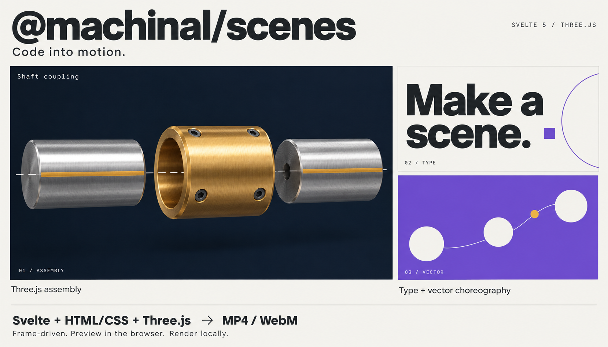

# @machinal/scenes

Author, preview and render frame-driven **Svelte 5**, HTML/CSS and Three.js scenes to **MP4 and WebM** with Go.

One npm package contains the runtime, Svelte integration, Node rendering API, CLI and precompiled native renderer. No private service or Go installation is required to author or export a video.



Build [frame-driven typography](#your-first-scene), vector choreography and [Three.js assemblies](#threejs-and-media).

## Install

In a Svelte 5 project with a Svelte-aware bundler, such as Vite:

```sh
npm install @machinal/scenes
```

Requires Node.js 22.12+ and Svelte 5.15+. Three.js and its public TypeScript types are installed as dependencies. There are no install scripts: Chromium and FFmpeg are downloaded only when you explicitly run `setup` or click **Download rendering tools** in the starter. The native renderer is already in the package. Run `npm install` inside a project directory, not a drive root such as `D:\`.

The library is ESM. The root and `/svelte` entrypoints contain Svelte components and runes, so they must be processed by a Svelte-aware bundler. Use `/runtime` for framework-independent code, plain Node.js imports and manifest validation.

## From a new project to an MP4

```sh
npx @machinal/scenes init my-scene
cd my-scene
npm install
npm run setup
npm run render
```

This creates **`scene.mp4`** and **`scene.mp4.scene.json`**, a manifest containing the output's dimensions, duration, frame count and SHA-256. `setup` is a one-time download of pinned Chrome Headless Shell and FFmpeg into a user cache; it checks that the tools execute. `npm run render` builds the scene with Vite and exports the video locally using the included renderer.

The CLI shows readable tool status and a short export summary, not the internal metadata report. For scripts that need the complete JSON result, use `npm run setup -- --json`, `npm run doctor -- --json` or `npm run render -- --json`. Progress stays on stderr; call `machinal-scenes render --json` directly for JSON-only stdout (the npm script also prints Vite build output). The Node API and saved manifests always retain the full metadata.

For the browser workflow, run `npm run dev` and open the local URL shown in the terminal:

1. **Preview**: play, pause, reset or scrub the default **1280 × 720** scene, scaled to fit the available preview space. No rendering tools are required.
2. **Download rendering tools**: the export panel checks the included renderer, Chrome and FFmpeg. If tools are missing, this explicit action downloads them once to your user cache. Already installed tools are marked **Ready**.
3. **Render MP4**: builds the current scene source and exports it locally, with visible status and renderer progress.
4. **Download MP4**: saves the completed video through your browser. A copy and its manifest also remain in a **local** `renders/` directory, created inside the starter next to its `package.json` when you render. For example, a starter at `D:\my-scene` saves browser exports under `D:\my-scene\renders\`. The completed export shows the full local path. Each export uses a unique filename; previous exports are preserved. Nothing is uploaded to S3 or Machinal, and the tool does not connect to your application or any Machinal project.

The browser export actions run only through the loopback Vite development server (`npm run dev`), not on a statically hosted build or `npm run preview`. They require same-origin requests; there is no cloud render service or automatic download on page load. The terminal workflow above remains available.

Edit `src/Title.svelte` to change the artwork and `scene.config.json` to change dimensions, FPS, duration, props or audio. `npm run doctor` checks rendering prerequisites without downloading anything.

The initializer refuses to overwrite an existing directory. Rendering also refuses to replace an existing video or manifest. Choose another output filename for another export:

```sh
npm run render -- --output second.mp4
```

The starter uses separate preview and capture pages. `scene.html` contains only the scene, so exported video does not include the preview's buttons, slider or heading.

## Your first scene

Create `Title.svelte`:

```svelte
<script lang="ts">
  import { SceneCanvas, useScene, interpolate } from '@machinal/scenes';

  let { title = 'Hello, scenes!' }: { title?: string } = $props();
  const scene = useScene();
  const x = $derived(interpolate(scene.frame.frame, [0, 60], [0, 200]));
</script>

<SceneCanvas background="#f5f2eb">
  <h1 style:transform="translateX({x}px)">{title}</h1>
</SceneCanvas>
```

Mount it from your browser entrypoint:

```ts
import { mountSvelteScene, exposeScene, type SceneRequest } from '@machinal/scenes';
import Title from './Title.svelte';

const request: SceneRequest = {
  version: 1,
  sceneId: 'title',
  props: { title: 'Hello, scenes!' },
  config: { width: 1280, height: 720, fps: 30, durationInFrames: 180 },
};

const controller = mountSvelteScene(
  Title,
  document.getElementById('scene')!,
  request,
  {},
);
const disconnect = exposeScene(controller);
await controller.ready();
await controller.seek(30); // One second into the scene; indexes start at zero.

window.addEventListener('pagehide', () => {
  disconnect();
  void controller.dispose();
}, { once: true });
```

Add `<div id="scene"></div>` to the page. `useScene()` and `SceneCanvas` must run inside a scene mounted with `mountSvelteScene()`; rendering them directly in an unrelated Svelte component does not establish scene context. In SvelteKit, mount from `onMount` and dispose on unmount rather than running this code during SSR.

`seek()` updates the Svelte component, seeks supported CSS animations and video, and waits for tracked resources, DOM images and fonts. Playback is driven by the host requesting frames; mounting does not automatically start a wall-clock animation.

## API map

| Import | Includes |
| --- | --- |
| `@machinal/scenes` | Runtime helpers and all Svelte components |
| `@machinal/scenes/runtime` | Frame/controller protocol, resources, seeded randomness, interpolation, choreography, geometry, object parameters, layout and asset-manifest validation; no Svelte or Three.js imports |
| `@machinal/scenes/svelte` | `mountSvelteScene`, `useScene`, `SceneCanvas`, `SceneVideo`, `SceneThree`, Three.js camera/light helpers and controlled model/texture loading |
| `@machinal/scenes/node` | Local `setup()`, `doctor()` and `renderVideo()`; no Svelte compilation or private service required to run a built scene |

All entrypoints belong to **one installed package**, not separate npm dependencies. Keep `/node` imports in Node/server code, not browser bundles. Internal source paths are not public entrypoints. Version `0.1.x` is an initial API; consult the changelog when upgrading.

### Three.js and media

`SceneThree` owns a Three.js renderer. Its `setup(context)` returns `update(frame)` and optional `dispose()`, synchronously or through a tracked promise. Derive transforms from absolute `frame.time`; do not accumulate deltas across seeks.

`SceneVideo` follows scene time, including backward seeks, reverse playback and freeze frames. Its media is silent: page audio is not captured by this library. Mix narration/music separately in the renderer.

For non-DOM resources, use `scene.resources.track(promise)` and honor `scene.resources.signal`. Arbitrary timers, network responses and third-party animation timelines are not made deterministic automatically. Pixel identity across browsers, operating systems and GPUs is not guaranteed.

## Local rendering

The included precompiled renderer supports **Windows x64, Linux x64, macOS x64 and macOS arm64**. The browser runtime can be used elsewhere, but native export on other targets is not supported in this release. No compilation is performed on the user's machine.

For an existing built scene project:

```sh
npx machinal-scenes setup
npx machinal-scenes render --request scene.config.json --serve dist --output output.mp4
```

The built page must mount and expose the scene controller as shown above. The request includes `url: "/scene.html"` in addition to the scene request fields. `--serve` starts an ephemeral loopback-only file server; it does not start or require the private Machinal service.

From Node:

```ts
import { setup, renderVideo } from '@machinal/scenes/node';

await setup(); // Explicit one-time downloads; omit after provisioning.
const asset = await renderVideo({
  request: 'scene.config.json',
  serveDirectory: 'dist',
  output: 'output.mp4',
  onProgress: message => process.stderr.write(message),
});
console.log(asset.file, asset.sha256);
```

`request` accepts a JSON/YAML filename or a `RenderRequest` object. Audio filenames in request files resolve relative to that file; object audio paths resolve relative to the working directory. Audio is mixed by FFmpeg, not captured from the browser.

For real alpha, set `config.transparent: true` and choose a `.webm` output. The renderer uses VP9 alpha; MP4 output is opaque H.264. `--lossless`, `--workers` and `--gpu` are available; run `npx machinal-scenes render --help` for options.

`setup` pins Chrome Headless Shell `151.0.7922.34` from Chrome for Testing and FFmpeg release `b6.1.1` from `eugeneware/ffmpeg-static`. FFmpeg archives, licenses and build information are checked against pinned SHA-256 values; native renderer binaries are checked against the packaged manifest. Browser downloads use the official HTTPS distribution and a fixed version; no independent browser checksum is asserted. FFmpeg's license and build/source information are retained beside the cached executable.

Use `--cache-dir` or `MACHINAL_SCENES_CACHE` to select another cache. Existing tools can be supplied with absolute `--browser`/`--ffmpeg` paths, the `SCENE_BROWSER`/`SCENE_FFMPEG` environment variables, or the Node API's `browserExecutable`/`ffmpegExecutable` options. Custom browser/tool versions are your compatibility responsibility.

Linux requires glibc, `unzip`, and Chromium's system libraries (NSS, ATK, X11, GBM, ALSA and related dependencies); minimal containers must provision them first. Windows uses its built-in `tar.exe` for browser extraction; macOS needs `unzip`. `setup` never runs privileged package-manager commands. Run as a non-root user to retain normal Chromium sandbox behavior. `--no-sandbox` is for externally isolated containers; the underlying chromedp allocator also disables the sandbox when launched as root.

Scenes are executable code, not a security sandbox. Use trusted scenes or provide your own execution isolation, authorization and resource limits.

## VS Code reports missing children or rejects onclick

These two diagnostics can appear together when the Svelte extension is running in **Restricted Mode**:

```text
Property 'children' is missing in type '{ background: string; }'
'"onclick"' does not exist in type 'HTMLProps<"button", HTMLAttributes<any>>'
```

In an untrusted workspace, the extension avoids loading the project's local compiler and can fall back to its bundled Svelte 4 compiler/types. The starter uses Svelte 5: nested component content supplies the `children` snippet, and `onclick` is a supported button attribute.

Open the generated starter directory itself in VS Code and run `npm install` there. If you have reviewed and trust its code, use **Workspaces: Manage Workspace Trust** to trust only that folder, then **Svelte: Restart Language Server**. Do not disable Workspace Trust globally. You can also validate the project independently of the editor:

```sh
npm run check
npm ls svelte
```

With the local Svelte 5 compiler, these starter components should pass the check. If the terminal also reports errors, investigate those diagnostics and the installed dependency versions rather than treating them as an editor-only issue. Do not make `SceneCanvas.children` optional or replace Svelte 5 event handlers just to suppress a mismatched editor diagnostic.

## License

Apache-2.0 for the library and renderer sources. See [LICENSE](LICENSE), [NOTICE](NOTICE), [LICENSING.md](LICENSING.md) and the included native third-party notices. Downloaded Chrome/FFmpeg and dependencies retain their own licenses; in particular, the downloaded FFmpeg builds have separate GPL/LGPL terms. This package license does not relicense those tools, the surrounding Machinal application or its private services.
